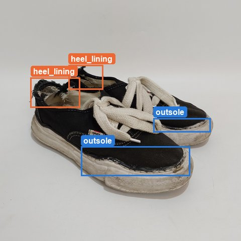
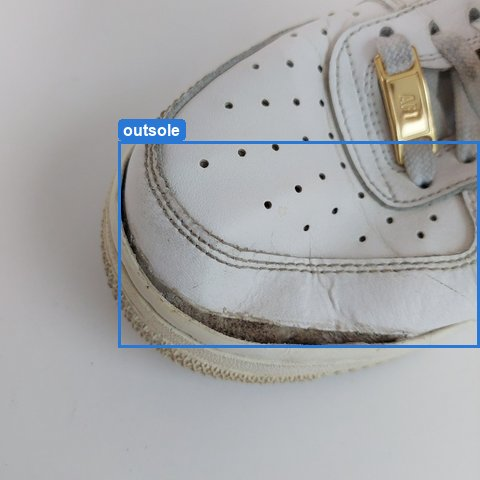
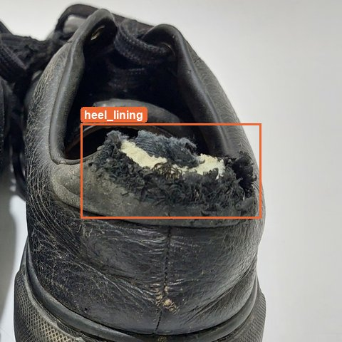
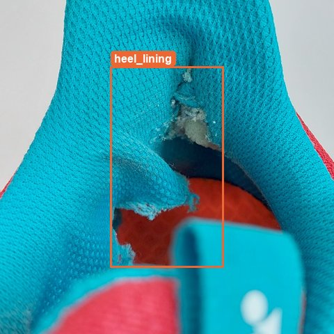
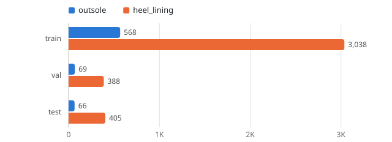
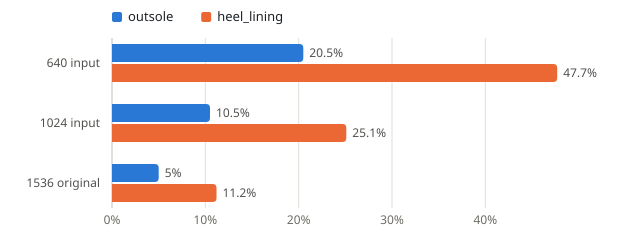
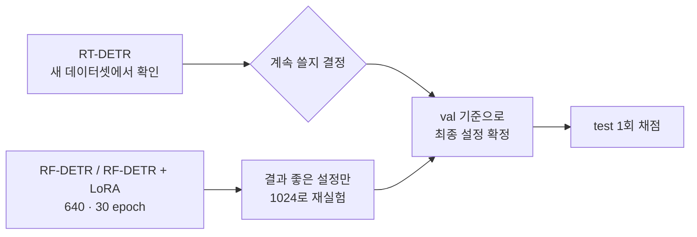
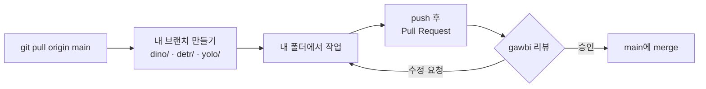

<div align="center">

# MEND AI

**신발 손상 부위 분류 · 탐지 모델 실험**


</div>

---

## Overview

신발 사진에서 손상된 자리를 찾는 모델을 실험하는 레포입니다.
**분류기**와 **탐지기**를 나눠 실험하고, 학습 설정과 결과를 정리합니다.

## Team

| 파트 | 모델 | 담당 | 폴더 |
|------|------|:--:|------|
| 분류기 | DINO | 재구 | [`classifier/dino/`](classifier/dino) |
| 탐지기 | DETR (RF-DETR, RT-DETR) | 광빈 | [`detector/detr/`](detector/detr) |
| 탐지기 | YOLO | 보인 | [`detector/yolo/`](detector/yolo) |

## Dataset

`dataset_damage` (2026-10-14) · 이미지 2,771장 · 1536×1536 · YOLO 형식 라벨

| 클래스 | 의미 |
|------|------|
| `outsole` | 밑창 손상 (벌어짐, 마모, 분리) |
| `heel_lining` | 뒤꿈치 안감 손상 |

박스는 부위 전체가 아니라 **손상된 자리**에 쳐져 있습니다.

### 라벨 예시

<p align="center">
  
  
  
  
</p>

정답 라벨입니다. 파란 박스가 `outsole`, 주황 박스가 `heel_lining`이고, 손상 부위 주변만 잘라 냈습니다.

### 클래스 · split별 박스 수

<picture>
  <source media="(prefers-color-scheme: dark)" srcset="docs/assets/box-counts-dark.svg">
  
</picture>

| split | 이미지 | outsole | heel_lining |
|------|--:|--:|--:|
| train | 2,209 | 568 | 3,038 |
| val | 279 | 69 | 388 |
| test | 283 | 66 | 405 |

outsole 박스가 heel_lining의 약 1/5이라, 성능은 클래스별로 따로 봅니다.

### 입력 해상도별 작은 박스 비율

짧은 변이 32px 미만인 박스의 비율입니다.

<picture>
  <source media="(prefers-color-scheme: dark)" srcset="docs/assets/small-boxes-dark.svg">
  
</picture>

640 입력이면 heel_lining 박스의 절반 가까이(47.7%)가 32px 미만으로 작아지고, 1024 입력이면 25.1%로 줄어듭니다.

> [!IMPORTANT]
> - split은 촬영일 단위로 나눠 두었습니다. 모델끼리 비교할 수 있도록 다시 나누지 않습니다.
> - 튜닝과 모델 선택은 val로만 하고, test는 설정을 다 정한 뒤 마지막에 한 번만 채점합니다.
> - 데이터셋은 팀 안에서만 공유하며 이 레포에는 올리지 않습니다.

## Detector · DETR

지금까지 실험해 보니 DETR 계열은 **과적합이 잘 생기는 편**이라, 과적합을 줄이는 방향으로 실험을 진행합니다.

### Model Comparison

지금까지 결과 기준, **과적합이 적은 순서**입니다.

| 순위 | 모델 | 과적합 | 비고 |
|:--:|------|:--:|------|
| 1 | **RF-DETR + LoRA** | 가장 적음 | 메인 후보 |
| 2 | RF-DETR | 보통 | 비교 기준 |
| 3 | RT-DETR | 가장 많음 | 새 데이터셋에서 한 번 확인한 뒤 쓸지 결정 |

> [!NOTE]
> RT-DETR은 아직 새 데이터셋으로 학습해 보지 않았습니다.

### Training Setup

| 항목 | 설정 | 이유 |
|------|------|------|
| Epochs | **30** | 보통 10~20 에폭 전에 best가 나오고 그 뒤로 성능이 떨어짐 |
| Resolution | **640** 기본 → **1024** 추가 실험 | 640에서 성능이 잘 나온 설정만 1024로 다시 돌려봄 |
| Main track | RF-DETR 계열 | 과적합이 가장 적음 |

### Experiment Flow



## Roadmap

**공통**
- [ ] 새 데이터셋 라벨링이 끝나면 공유
- [ ] 평가지표 정해서 통일

**Detector · DETR**
- [ ] RT-DETR 3-seed 실험 결과 공유 (산학 쪽에서 학습 중)
- [ ] RT-DETR을 새 데이터셋에서 확인하고 쓸지 결정
- [ ] RF-DETR / RF-DETR + LoRA 실험 @ 640
- [ ] 결과가 좋은 설정은 1024로 다시 실험

## 협업 규칙

충돌을 줄이고 변경 사항을 한곳에서 확인할 수 있도록 아래처럼 진행합니다.

```
classifier/dino/   DINO 분류기 (재구)
detector/detr/     DETR 탐지기 (광빈)
detector/yolo/     YOLO 탐지기 (보인)
```



1. 작업 전에 `git pull origin main`으로 최신 내용 받기
2. 내 브랜치 만들기: `dino/<작업명>`, `detr/<작업명>`, `yolo/<작업명>`
3. 되도록 **내 파트 폴더 안에서만** 수정
4. push 후 `main`으로 **Pull Request** 열기 → 템플릿에 맞춰 작업 내용 보고
5. @gawbi 승인 후 merge

> [!IMPORTANT]
> `main`에는 직접 push하지 않습니다. 모든 변경은 Pull Request로 올리고 @gawbi 승인 후 merge합니다.
> 모델 가중치·데이터셋 같은 큰 파일은 올리지 않습니다.

## Contributors

<a href="https://github.com/gawbi">
  
</a>

## Built by

**[@gawbi](https://github.com/gawbi)**
