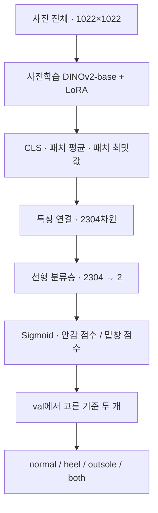

# Classifier · DINO

**담당:** 재구

DINO 분류기 실험 코드와 결과를 이 폴더에 정리합니다.

## 현재 완료 상태 · 2026-10-19

EX-02~07과 YOLO-01의 승인된 9번 단계까지 학습·합산 val 평가를 마쳤습니다. 마지막 비교는 07:57에 종료됐고 GPU 프로세스는 모두 종료했습니다. test와 DETR 결합은 실행하지 않았습니다.

| 후보 | 균형 정확도 | 전체 정확도 |
|---|---:|---:|
| DINOv3 LoRA + TTA (EX-06) | 86.10% | 85.14% |
| YOLO26m NMS + TTA (Y2) | 76.43% | 79.91% |
| DINO + YOLO 50:50 | 86.32% | 83.93% |

합산 val 1,319장에서 후보와 판정 기준을 선택한 개발 결과입니다. 결합은 균형 정확도 +0.22%p, 전체 정확도 −1.21%p이며, 신발 그룹 분리 보조 검증의 차이 구간도 0을 포함합니다. 현재 기준 모델은 DINOv3 LoRA + TTA로 두고, 상세 조건·다른 후보·4×4 혼동행렬은 [EXPERIMENTS.md](EXPERIMENTS.md)에 보관합니다.

추가 경로는 `linear_probe/`(고정 백본 분류층), `normalized_probe/`(분류층 정규화), `lora_plus_tta/`(LoRA+·TTA), `yolo_pipeline/`(YOLO·사진 점수 결합), `analysis/`(저장 결과 CPU 분석)입니다. 각 실행은 소스·설정·데이터 해시를 검증하며, 학습 당시 봉인한 소스와 현재 소스가 다르면 해당 run의 보존 소스를 사용합니다.

## 첫 실험 설계

**DINOv2-base + LoRA, 1022×1022 입력, 30 epoch**로 사진 단위 손상 분류기를 학습합니다. 사진마다 안감 손상과 밑창 손상 점수를 내고, 판정 기준 두 개로 normal / heel / outsole / both를 정합니다.

2026-10-17 사용자 결정은 DINOv2 + LoRA, 1022 입력, 30 epoch와 공통 평가지표입니다. 아래 세부 학습값으로 코드를 구현했습니다. 배치·checkpointing은 실제 GPU 점검 후 본 학습 전에 확정합니다. 실행 상태와 측정 결과는 실험 기록을 따릅니다.

실험별 설정과 결과는 [EXPERIMENTS.md](EXPERIMENTS.md)에 기록합니다. 이 문서는 학습 구조와 평가 절차를 설명합니다.

EX-01은 원래 30 epoch 스케줄의 12 epoch에서 사용자 결정으로 중단하고 val 평가를 마쳤습니다. 해당 소스는 커밋 `fffe122`에 보존했습니다. 아래 첫 실험의 설계값과 실제 완료 결과는 구분합니다.

## EX-02 DINOv3 설계와 실행 절차

EX-02는 **DINOv3 ViT-B/16 + LoRA, 1024×1024 입력, 15 epoch**입니다. 2026-10-18 사용자 승인으로 점검·본 학습·최종 val 평가를 완료했습니다. 아래는 해당 실행의 설계와 절차이며, 실제 설정과 결과는 실험 기록을 따릅니다.

- 설정: [`configs/dinov3b_lora_1024_e15.json`](configs/dinov3b_lora_1024_e15.json)
- 백본: `facebook/dinov3-vitb16-pretrain-lvd1689m`, revision `5931719e67bbdb9737e363e781fb0c67687896bc`
- 입력: 기존 1024px 사본에서 사진 전체를 유지해 1024 정사각형으로 패딩합니다. 16×16 패치 4,096개를 사용합니다.
- 특징: CLS + **register 4개를 제외한** 패치 평균·최댓값, `2304 → 2` 분류층입니다. query/value 24곳의 LoRA 설정과 출력 순서는 EX-01과 같습니다.
- 스케줄: warmup 1 epoch + 15 epoch 전체에 맞춘 cosine, 총 optimizer 갱신 8,595회입니다. 판정 기준은 EX-02 종료 후 합산 val에서 새로 선택합니다.
- 환경: 기존 DINO 가상환경을 읽어 사용합니다. 새 가중치 캐시는 현재 저장소의 Git 제외 경로 `runs/dino/hf_cache/`에 두며 MENDI의 환경·캐시는 수정하지 않습니다. 로그인 토큰은 설정·코드·문서에 넣지 않습니다.
- 짧은 점검은 train 128장만 사용합니다. 점검 가중치는 버리고 본 학습을 새로 초기화합니다. 메모리·저장·재로딩 결과와 확정 배치 조합은 실험 기록에 둡니다.

DINOv2는 14배수 입력과 register 없는 특징 처리를 유지합니다. 모델의 패치 크기·register 수·입력 크기·LoRA 적용 대상이 예상과 다르면 실행을 중단합니다. [DINOv3 공식 모델 카드](https://huggingface.co/facebook/dinov3-vitb16-pretrain-lvd1689m)

EX-01 재평가에는 `fffe122`의 소스와 기존 실행 폴더를 사용합니다. 코드 해시 검사를 우회하거나 EX-01 체크포인트에 새 소스의 해시를 덮어쓰지 않습니다. EX-02는 별도 실행 폴더와 `EX-02-RUNTIME` 영역을 사용해 기존 결과를 보존합니다.

## EX-03 분류층만 학습

**DINOv3 ViT-B/16 사전학습 백본을 고정하고 LoRA 없이 새 `Linear(2304, 2)`만 15 epoch 학습**하는 후보입니다. 상세 설정·특징 캐시·평가·검증은 [EXPERIMENTS.md의 EX-03](EXPERIMENTS.md#ex-03-dinov3-고정-특징--선형-분류층)에 정리했습니다.

2026-10-18 사용자가 실행을 승인했고, 이어 **분류층 학습·최종 val 추론도 GPU에서 진행**하도록 변경했습니다. train의 약한 증강 4개 view와 val의 무증강 특징을 GPU로 저장한 뒤, 같은 캐시로 GPU 분류층을 학습합니다. 실제 진행 상태는 실험 기록을 따릅니다. 기존 LoRA 경로와 분리된 `linear_probe/`를 사용합니다.

```text
<Python> -m classifier.dino.linear_probe --stage check --config classifier/dino/configs/dinov3b_linear_1024_e15.json --run-dir <run> --backbone-path <snapshot>
<Python> -m classifier.dino.linear_probe --stage smoke --run-dir <run>
<Python> -m classifier.dino.linear_probe --stage extract --run-dir <run>
<Python> -m classifier.dino.linear_probe.gpu_head --stage prepare --run-dir <run>
<Python> -m classifier.dino.linear_probe.gpu_head --stage continue --run-dir <run>
```

GPU 실행 모듈은 별도 GPU 프로세스의 학습 → 별도 GPU 프로세스 최종 평가를 연결하고, 종료 후 GPU를 비웁니다. 같은 run의 학습 재개는 `classifier.dino.linear_probe.gpu_head --stage continue --run-dir <run> --resume`, 평가만 재실행할 때는 `--stage evaluate --run-dir <run>`을 사용합니다. 캐시·설정·소스 해시가 다르면 재사용을 거부합니다. 분류층은 `head.pt`, 추론 조건은 `inference_config.json`, 합산 결과는 `metrics.json`·`val_combined_probs.csv`·`report.md`에 저장합니다. test와 후속 실험은 자동 실행하지 않습니다.

진행 중인 추출을 유지하기 위해 원래 추출의 `protocol.json`·`config.json`·소스는 보존했습니다. 실제 분류층 장치 설정은 `gpu_head_config.json`, 추출 출처와 GPU 소스 연결 기록은 `gpu_head_protocol.json`을 따릅니다. 현재 실행은 기존 CPU 후속 실행기를 해제하고 `linear_probe/gpu_head/run_gpu_head.cmd <Python> <run> <추출 PID>`로 연결했습니다. 추출 로그는 `console.log`, 분류층 로그는 `gpu_head_console.log`입니다. 원래 `run_linear_probe.cmd`는 CPU 계획의 보존본이므로 GPU 실험에는 사용하지 않습니다.

EX-03 학습·GPU 평가는 완료됐고, 이후 문서 표 갱신 오류를 수정했습니다. 원래 실행의 봉인 소스·가중치·예측·지표는 보존했습니다. `<Python> -m classifier.dino.tools.finalize_linear_report --run-dir <run>`은 봉인 snapshot과 저장물을 검증해 보고만 복구하는 CPU 명령입니다. 현재 수정된 소스로 원래 실행의 학습·추론 해시 검사를 우회하지 않습니다.

## EX-04·05 학습된 LoRA의 분류층 정규화 비교

2026-10-18 사용자 요청으로 기존 DINOv2·DINOv3 LoRA 두 모델을 각각 고정한 뒤 분류층의 특징 정규화를 비교합니다. `normalized_probe/`는 모델별 새 특징 캐시를 추출하고, train에서만 특징별 평균·표준편차를 계산합니다. 원래 분류층의 초기 판정 함수를 보존하면서 정규화 없는 대조군과 정규화 분류층을 각각 GPU 15 epoch 학습합니다. 원본 모델·판정 기준·결과는 보존합니다.

```text
<Python> -m classifier.dino.normalized_probe --stage prepare --run-dir <run> --origin-run <original-run> --experiment EX-04
<Python> -m classifier.dino.normalized_probe --stage extract --run-dir <run>
<Python> -m classifier.dino.normalized_probe --stage train --run-dir <run>
<Python> -m classifier.dino.normalized_probe --stage evaluate --run-dir <run>
<Python> -m classifier.dino.normalized_probe --stage compare --runs <run-v2> <run-v3> --output <comparison-dir>
```

두 번째 prepare는 EX-05와 EX-02 원본을 사용합니다. EX-04 원본은 EX-01의 12 epoch 체크포인트입니다. `normalized_probe/run_pair.cmd <Python> <run-v2> <run-v3> <comparison-dir>`는 승인된 두 실험을 순차 실행하고 별도 GPU 프로세스의 최종 평가·CPU 비교를 연결합니다. 각 run의 `report.md`는 원본·대조군·정규화의 합산 지표와 혼동행렬을, 비교 경로의 `report.md`는 두 모델 비교와 신발 그룹 내부 검증을 담습니다. 정규화의 직접 효과는 대조군 대비로 해석합니다. test는 사용하지 않습니다.

## EX-06 LoRA 학습률 + CLS·평균

2026-10-18 사용자 승인으로 DINOv3 LoRA 학습률을 `1e-4 → 3e-5`, 특징을 `CLS+평균+최댓값 → CLS+평균`으로 함께 바꿉니다. 분류층은 `Linear(1536, 2)`입니다. 기존 사전학습 revision에서 LoRA와 분류층을 새로 초기화하며, 입력 1024·15 epoch·seed 0·batch 1 × 누적 8·checkpointing 끔과 나머지 EX-02 설정을 유지합니다. 특징 표준화는 적용하지 않습니다.

설정은 [`configs/dinov3b_lora_clsmean_lr3e5_1024_e15.json`](configs/dinov3b_lora_clsmean_lr3e5_1024_e15.json)입니다. 기존 LoRA 명령의 `--config`에 이 파일을 지정합니다. `run_training.cmd <Python> <run> <snapshot> <EX-02-run>`의 선택 인자 네 번째 경로를 주면 마지막 가중치의 합산 val 평가·보고 후 기존 실험과의 비교도 CPU로 자동 기록합니다. 두 변경의 개별 효과는 분리하지 않습니다. test와 후속 실험은 실행하지 않습니다.

## EX-07과 TTA 자동 후속 실행

2026-10-18 사용자가 EX-06 최종 val → 좌우 반전 TTA 전후 비교 출력 → 같은 조건의 EX-07 LoRA+ 학습·val → LoRA+ TTA → 네 결과 비교 출력을 연속 실행하도록 승인했습니다. 추가 경로는 `lora_plus_tta/`이며 진행 중인 EX-06의 공유 소스와 기록을 보존합니다. LoRA+는 공식 PEFT helper를 백본에만 적용하고 A LR `3e-5`, B LR `4.8e-4`, head LR `1e-3`, weight decay `0.01`을 유지합니다. EX-07도 사전학습 가중치에서 새로 시작합니다.

```text
<Python> -m classifier.dino.lora_plus_tta --stage prepare --chain-dir <chain> --origin-run <EX-06-run> --plus-run <EX-07-run> --wait-for-pid <EX-06-wrapper-PID>
lora_plus_tta/run_chain.cmd <Python> <chain>
```

`<chain>`과 두 run은 이 저장소의 `runs/dino/` 안에 둡니다. prepare는 CPU만 사용합니다. controller도 CUDA를 차단하고 성공한 선행 실행을 기다립니다. GPU 작업은 하나씩 별도 프로세스로 실행합니다. LoRA+는 이 모듈의 `smoke-plus`·`train-plus` 단계로 실행해야 하며 일반 `train.py` 진입점으로 실행하지 않습니다. 재개는 `<Python> -m classifier.dino.lora_plus_tta --stage queue --chain-dir <chain> --resume`을 사용합니다. 소스·설정·데이터 검증을 우회하지 않습니다.

후속 경로의 `status.json`·`console.log`가 전체 진행을, EX-07의 `console.log`·`epochs.json`이 학습 진행을 담습니다. 중간 결과는 `lora_tta_comparison.md`, 최종 네 결과는 `final_comparison.md`와 동명 JSON입니다. 각 TTA 폴더는 별도 확률·지표·추론 설정·원본 재현 및 보존 증거를 보관합니다. 두 비교 보고서는 콘솔과 `EXPERIMENTS.md`에도 자동 출력합니다. test는 사용하지 않습니다.

## 데이터와 전처리

2026-10-17 확정본을 사용합니다. 경로는 저장소 루트 기준입니다.

| 용도 | 이미지 폴더 | 사진 단위 정답 | 사진 수 |
|---|---|---|---:|
| 학습 | `dataset/mendi_damage_v5/dataset_damage_v5_1024/images/train/` | `photo_labels/damage_image_labels_v5.csv`의 train 행 | 4,584 |
| v5 검증 | `dataset/mendi_damage_v5/dataset_damage_v5_1024/images/val/` | 같은 CSV의 val 행 | 639 |
| 2025년 검증 | `dataset/mendi_damage_v5/dataset_damage_eval25_1024/images/val/` | `photo_labels/damage_image_labels_eval25.csv`의 val 행 | 680 |

표의 `photo_labels/`는 `dataset/mendi_damage_v5/` 아래입니다. split을 유지하고 train 전체를 학습에 씁니다. 기존 코드의 train fit/hold 재분할은 사용하지 않습니다. 2025년 평가셋은 박스 라벨이 비어 있으므로 사진 단위 CSV 정답을 사용합니다.

전처리는 다음 순서로 고정합니다.

1. 이미지를 RGB로 읽고 EXIF 회전 상태를 처리합니다. 확정본은 회전이 픽셀에 반영되어 있습니다.
2. 사진 전체를 유지하고, 종횡비를 보존해 긴 변을 1022px로 LANCZOS 축소합니다.
3. 짧은 변을 양쪽으로 패딩해 1022×1022로 만듭니다. 홀수 패딩의 여분은 오른쪽·아래에 둡니다. 패딩 색은 RGB `(124, 116, 104)`입니다.
4. 픽셀을 0~1로 바꾸고 ImageNet 평균 `(0.485, 0.456, 0.406)`, 표준편차 `(0.229, 0.224, 0.225)`로 정규화합니다.

학습에만 좌우 반전(확률 0.5)과 밝기·대비·채도 변화(각 0.9~1.1배)를 적용합니다. 색 변화는 패딩 전에 적용합니다. 손상 부위가 사라질 수 있는 랜덤 크롭과 손상 부위 잘라내기는 사용하지 않습니다. 검증·추론은 증강 없이 같은 크기 조정·패딩·정규화를 적용합니다.

DINOv2의 패치는 14×14입니다. 1022 입력은 73×73 패치가 됩니다. 기본 이미지 프로세서의 224px 크기 조정·중앙 크롭이 다시 적용되지 않도록 입력 텐서 크기를 확인합니다. [DINOv2 공식 문서](https://huggingface.co/docs/transformers/model_doc/dinov2)

## 모델 구조



백본은 Hugging Face의 `facebook/dinov2-base`를 `AutoModel.from_pretrained`로 불러옵니다. 모델 revision과 라이브러리 버전을 실행 기록에 남기고 재개·추론에서도 같은 revision을 사용합니다.

마지막 층의 CLS, 패치 평균, 패치 최댓값은 각각 768차원입니다. 세 특징을 연결해 2304차원으로 만들고, `Linear(2304, 2)`로 점수 두 개를 냅니다. 이 특징 조합은 기존 예비 실험 EX-15의 출발 설정을 재사용한 것입니다. 현재 데이터에서 최적임이 확인된 설정은 아닙니다.

출력 순서는 **`heel_lining, outsole`**로 고정합니다. 박스 라벨 ID 순서(`0 = outsole, 1 = heel_lining`)와 다르므로, CSV와 앙상블에서는 열 이름으로 연결합니다.

| 사진 정답 | 안감 학습값 | 밑창 학습값 |
|---|---:|---:|
| normal | 0 | 0 |
| heel | 1 | 0 |
| outsole | 0 | 1 |
| both | 1 | 1 |

기존 백본 가중치는 고정하고 LoRA와 분류층만 학습합니다. LoRA는 attention의 query·value 선형층 24곳에 적용하며, 실제 모듈 이름을 검사해 기록합니다. 적용 대상이 예상과 다르면 학습을 중단합니다. 기존 가중치를 고정해도 LoRA 학습 경로에는 gradient가 필요하므로 백본 전체를 `no_grad`로 감싸지 않습니다.

## 학습 설정

| 항목 | 첫 실험 설정 |
|---|---|
| 백본 | `facebook/dinov2-base`, 레지스터 없는 base |
| LoRA | query·value, rank 8, alpha 16, dropout 0.1, bias 학습 없음 |
| 분류층 | `Linear(2304, 2)`, 새로 초기화해 학습 |
| Epochs | **30**, 조기 종료 없음 |
| Seed | 0 |
| 정밀도·attention | bf16 autocast, SDPA |
| 물리 배치·누적 | batch 1 × 누적 8회부터 점검, 유효 배치 8 |
| Optimizer | AdamW, weight decay 0.01 |
| 초기 학습률 | LoRA `1e-4`, 분류층 `1e-3` |
| 스케줄 | 첫 1 epoch 선형 warmup, 이후 30 epoch 끝까지 cosine 감소 |
| 손실 | `BCEWithLogitsLoss`, 클래스별 `pos_weight` 적용 |
| Gradient clipping | optimizer 갱신 직전에 전체 학습 파라미터 norm 1.0 |
| DataLoader | workers 1, 이미지 RAM 캐시 없음 |
| 비교 가중치 | **30 epoch의 last**, best 선택 없음 |

`pos_weight`는 train에서만 `음성 수 / 양성 수`로 계산합니다. 라벨이 both인 사진은 두 출력 모두 양성입니다. 정답 비율과 판정 기준은 val로 확인하며, 첫 실험에는 가중 샘플러를 함께 적용하지 않습니다.

배치 누적 중에는 누적 구간의 실제 샘플 수에 맞게 손실을 정규화합니다. optimizer와 학습률 스케줄은 누적이 끝날 때 한 번씩 갱신합니다. 현재 train 4,584장·유효 배치 8이면 epoch당 573회, 30 epoch에 총 17,190회 갱신합니다. 중단 후 재개해도 warmup·스케줄을 처음부터 다시 시작하지 않습니다. [PyTorch 배치 누적 설명](https://docs.pytorch.org/docs/stable/notes/amp_examples.html#gradient-accumulation)

## 메모리와 시간 점검

실행 전 Python·CUDA·bf16·SDPA 동작과 GPU 사용 현황을 확인합니다. 기존 DINO 가상환경은 격리 권한 밖에서 정상 실행되는 것을 확인했습니다. 같은 환경과 백본 캐시를 읽어 쓰며, MENDI의 원본 코드·환경·캐시는 수정하지 않습니다.

긴 학습 전에 train의 128장으로 짧은 학습을 수행합니다. 처음 모델 로딩·warmup과 안정화된 처리 시간을 구분하고, forward·backward·optimizer 갱신·저장 후 재로딩까지 확인합니다. LoRA와 분류층에 gradient가 생기고 기존 백본 가중치는 갱신되지 않는지 점검합니다.

메모리 목표는 학습 프로세스의 PyTorch reserved 6.5GiB 이내입니다. `nvidia-smi`에서 다른 프로세스 사용량과 실제 여유도 함께 확인합니다. batch 1에서 부족하면 gradient checkpointing을 켜고 재측정합니다. batch 1·checkpointing으로도 부족하면 본 학습을 시작하지 않고 결과를 보고합니다. 입력 크기를 자동으로 바꾸지 않습니다.

메모리가 충분하면 batch 2 × 누적 4, batch 4 × 누적 2도 같은 128장으로 비교합니다. 유효 배치 8을 유지하고, 메모리 한도와 처리량으로 실행 조합을 정해 본 학습 전에 고정합니다. 정확도 점수로 배치 조합을 고르지 않습니다.

128장 점검은 메모리와 대략적인 시간 추정용입니다. 모델 구조·checkpointing·배치 조합을 바꾸면 다시 측정하며, 성공한 점검의 가중치는 버리고 seed와 모델을 초기화한 뒤 본 학습을 시작합니다. 첫 epoch의 실제 시간으로 남은 시간을 다시 계산합니다. epoch별 검증과 저장 시간도 포함해 보고합니다.

## 검증과 판정 기준

검증 보고는 **v5 val 639장 + val25 680장을 합친 1,319장**의 결과 하나로 통일합니다 (사용자 결정, 2026-10-17). epoch별 고정 기준 `(0.5, 0.5)` 기록도 보고할 때는 합산합니다. 손실은 사진 수로 가중 평균하고, 정확도·재현율·균형 정확도는 합친 혼동 행렬에서 계산합니다. 기존 원본 이력은 재현용으로 보존하며, 합산 이력은 `epochs_combined.json`에 저장합니다.

30 epoch 학습 후 last 가중치를 재로딩해 두 val의 사진별 점수를 저장하고, 판정 기준을 한 번 선택합니다. 선택 절차는 첫 실험 제안으로 다음과 같이 고정합니다.

1. v5 val 639장과 val25 680장을 합친 1,319장에서 기준을 고릅니다.
2. 안감·밑창 기준을 각각 0.01~0.99, 간격 0.01로 두고 두 기준의 조합을 평가합니다. 각 출력 점수가 기준 **이상**이면 해당 손상이 있다고 판정합니다.
3. **합친 val의 균형 정확도**가 가장 높은 조합을 선택합니다. 동점이면 전체 정확도, 두 기준이 0.5에서 떨어진 거리의 합이 작은 순으로 고릅니다. 그래도 같으면 안감 기준, 밑창 기준이 작은 순으로 정합니다.
4. 선택한 공통 기준으로 **합산 val 결과만** 보고합니다. 시기별 결과를 나누거나 두 점수를 단순 평균하지 않습니다.

기준을 고른 val의 점수는 모델·기준 선택에 사용한 검증 결과입니다. 최종 일반화 성능은 이후 설정을 고정하고 test에서 확인합니다. 다른 모델·앙상블과 비교할 때도 같은 데이터와 기준 선택 절차를 사용합니다.

| 안감 기준 통과 | 밑창 기준 통과 | 판정 |
|---|---|---|
| 아니요 | 아니요 | normal |
| 예 | 아니요 | heel |
| 아니요 | 예 | outsole |
| 예 | 예 | both |

## 공통 평가 출력

모든 모델은 **합산 val의 4×4 혼동 행렬 하나 + 지표 요약 표 한 행**으로 보고합니다. 혼동 행렬의 행은 실제 정답, 열은 예측이며, 순서는 `normal, heel, outsole, both`입니다.

| 지표 | 계산 |
|---|---|
| **균형 정확도 · 핵심** | normal·heel·outsole 재현율의 평균 |
| 전체 정확도 | 대각선의 합 ÷ 전체 사진 수 |
| 클래스별 재현율 | 해당 클래스의 대각선 값 ÷ 해당 행의 합 |

현재 val에는 both 정답이 없습니다. both 재현율은 `N/A`로 표시하고 평균에서는 제외합니다. both로 잘못 예측한 사진은 전체 정확도와 실제 클래스 재현율에서 오답입니다. 양쪽 손상 비트 중 하나만 맞힌 경우 부분 점수를 주지 않습니다.

혼동 행렬은 건수 표를 기본으로 저장합니다. 요약 표에는 모델·합산 검증셋·사진 수·균형 정확도·전체 정확도·클래스별 재현율을 표시합니다. 최종 선택 기준과 고정 기준 0.5 결과를 함께 기록할 때는 기준 종류를 구분합니다.

학습·짧은 점검에서는 test 이미지를 열거나 test 점수를 계산하지 않습니다. 정답 CSV는 train·val 행만 유지하고, test 평가는 사용자가 요청한 최종 단계에 별도 명령으로 수행합니다.

## 구현 후 확인할 것

- 입력 크기·클래스 순서·사진 단위 정답 변환이 설계와 일치하는지 확인합니다. 특히 세로 사진이 잘리거나 늘어나지 않는지 확인합니다.
- train과 두 val 사이의 파일·세션·신발 그룹 중복, 정답 누락·중복, 사진과 CSV 불일치를 점검합니다. 분할은 새로 만들지 않습니다.
- 손으로 답을 정한 작은 혼동 행렬로 정확도·재현율·균형 정확도와 both 오판 처리를 검증합니다. 빈 정답 클래스는 재현율 `N/A`로 처리하고, 현재 val의 평균에는 normal·heel·outsole만 포함합니다.
- 학습 점검에서 gradient 누적과 스케줄 갱신 횟수를 확인합니다. 짧은 저장·재개가 동일 설정의 연속 실행과 맞는지도 확인합니다.
- 최종 저장물을 새 프로세스로 불러와 같은 val 사진의 점수가 허용 오차 내에서 재현되는지 확인합니다. 데이터·전처리·출력 순서가 다른 체크포인트로 재개하지 않습니다.

## 구현할 파일과 저장할 산출물

구현한 파일은 다음과 같습니다.

| 파일 | 역할 |
|---|---|
| `data.py` | train·val 정답, 분할·파일 점검, 전처리 |
| `model.py` | 사전학습 백본, LoRA, 특징 결합, 2출력 분류층 |
| `train.py` | 짧은 점검, 실험 설정에 따른 학습·누적·재개·epoch별 검증 |
| `evaluate.py` | 사진별 점수 저장, 기준 선택, 혼동 행렬·요약 표 |
| `configs/dinov2b_lora_1022_e30.json` | 첫 실험의 경로·학습·전처리 설정 |
| `configs/dinov3b_lora_1024_e15.json` | EX-02 DINOv3 1024 입력·15 epoch 설정 |
| `run_training.cmd` | 학습과 별도 프로세스의 최종 평가를 순서대로 실행하고 종료 코드를 기록 |
| `tests/test_pipeline.py` | 지표·판정 기준·전처리·배치 누적·재개의 CPU 검증 |
| `tests/test_backbones.py`, `tests/test_experiment_records.py` | register 제외·모델별 입력 규격·기존 실험 기록 보존의 CPU 검증 |
| `tools/report_combined.py` | 기존 예측을 재검산해 합산 지표·혼동 행렬·보고서 생성. 모델·GPU 사용 없음 |

저장소 루트에서 다음 명령을 사용합니다. `<Python>`은 기존 DINO 가상환경 실행 파일, `<config>`는 실행할 실험의 JSON, `<snapshot>`은 config의 revision과 같은 이름의 로컬 백본 snapshot 폴더입니다. `<run>`은 현재 저장소의 `runs/dino/` 아래 경로입니다. EX-02는 `--config classifier/dino/configs/dinov3b_lora_1024_e15.json`을 명시합니다.

```text
<Python> -m unittest discover -s classifier/dino/tests -v
<Python> -m classifier.dino.train --config <config> --stage check --run-dir <run> --backbone-path <snapshot>
<Python> -m classifier.dino.train --config <config> --stage smoke --run-dir <run> --backbone-path <snapshot>
<Python> -m classifier.dino.train --config <config> --stage train --run-dir <run> --backbone-path <snapshot>
<Python> -m classifier.dino.evaluate --run-dir <run>
<Python> classifier/dino/tools/report_combined.py --run-dir <run>
```

재개할 때는 같은 run 경로에 `--config <run>/config.json --stage train --resume`을 사용합니다. 설정·데이터·코드 해시가 다르면 재개하지 않습니다. Windows 장기 실행은 `run_training.cmd <Python> <run> <snapshot>`을 숨김 프로세스로 시작하며, 점검 때 저장한 `<run>/config.json`을 자동으로 읽습니다. 최종 평가가 실패하면 로그와 `evaluation_failure.json`을 확인하고 평가 명령만 다시 실행합니다.

최종 평가 명령 뒤에는 합산 보고 명령을 실행합니다. 장기 실행기와 중단 평가 도구는 이 단계를 자동으로 수행합니다. 보고용 파일은 `metrics.json`의 `val_combined`, `val_combined_probs.csv`, `val_combined_confusion.csv`, `report.md`입니다. 원본 이력과 개별 예측은 재현용이며, 보고서는 합산 결과만 표시합니다.

사용자가 고정 epoch 계획을 중간에 변경한 경우에는 원래 config와 스케줄을 보존합니다. 완료된 epoch의 체크포인트를 별도로 보존하고 `stop_decision.json`에 사용자 결정과 실제 완료 epoch를 기록한 뒤 학습을 중단합니다. EX-01의 승인된 12 epoch 중단 평가는 `<Python> classifier/dino/tools/evaluate_stopped.py --run-dir <run>`으로 수행합니다. 이 도구는 중단 결정·체크포인트·원래 데이터 및 코드 해시의 일치를 확인하고 val만 평가합니다. 보고서에는 예정 30 epoch와 실제 12 epoch를 구분합니다.

실행 산출물은 Git에서 제외되는 저장소 루트의 `runs/dino/<실험번호>_<실행시각>/`에 둡니다. 같은 실험을 재실행하면 새 폴더를 사용하고, resume은 지정한 폴더에서만 수행합니다.

- 설정·환경: 입력 설정, 백본 revision, 패키지 버전, 코드 커밋·변경 상태, seed, 사용한 train·val 명세의 해시, 전처리와 클래스 순서
- 학습: epoch별 손실·학습률·검증값·시간·최대 GPU 메모리, 실행 로그
- 복구: LoRA·분류층·optimizer·scheduler·완료 epoch·난수·셔플 상태를 담은 `last.pt`. 완결된 epoch 경계에서 임시 파일을 원자적으로 교체하고, 재개 시 데이터·설정 일치를 확인
- 최종 추론: LoRA 어댑터, 분류층 가중치, 판정 기준과 선택 절차. 백본 revision·입력 설정도 함께 저장
- 평가: `val_probs.csv`, `val25_probs.csv`, 기준별 평가 JSON, 혼동 행렬 CSV, 요약 표 Markdown

예측 CSV의 열은 `file,p_heel_lining,p_outsole`로 고정하고 split별로 파일을 나눕니다. 학습 중에는 epoch마다 `last.pt`를 교체하고, 완료 후 최종 가중치와 평가 결과를 보존합니다. 사진·가중치·실행 산출물은 커밋하지 않습니다.

긴 학습은 로그를 남기는 별도 프로세스로 실행합니다. 기본 절차는 학습 종료 → val 보고 → 다음 요청 대기입니다. 사용자가 연속 실행을 승인했던 EX-06 TTA → EX-07 LoRA+·TTA와 YOLO-01의 9번까지는 지정한 순서로 연결했고 모두 완료했습니다. 이후 학습은 새 요청을 기다립니다.
