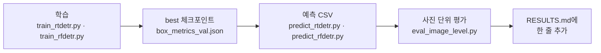

# Detector · DETR

**담당:** 광빈

RT-DETR / RF-DETR 실험 코드와 결과를 이 폴더에 정리합니다.
팀 공통 규칙과 실험 배경은 [루트 README](../../README.md), 실험 결과는 [RESULTS.md](RESULTS.md)에 있습니다.

## 모델

모델 코드는 직접 짜지 않고 라이브러리 구현을 그대로 씁니다.

| 모델 | 라이브러리 | 사전학습 가중치 | 비고 |
|------|------|------|------|
| RT-DETR-l | Ultralytics `ultralytics` 8.4.178 | `rtdetr-l.pt` (COCO) | |
| RF-DETR-S | Roboflow `rfdetr` 1.11.2 | RF-DETR Small | |
| RF-DETR-S + LoRA | Roboflow `rfdetr` 1.11.2, `backbone_lora=True` | RF-DETR Small | 라이브러리 내장 LoRA. DINOv2 백본에 DoRA rank 16, 적용 레이어는 라이브러리가 고정 |

## 폴더 구성

이 폴더:

| 파일 | 역할 |
|------|------|
| `common.py` | 클래스 이름, 예측 CSV 형식, 가중치 폴더로 chdir, 학습 중 절전 방지 |
| `train_rtdetr.py` | RT-DETR 학습. 끝나면 best.pt를 v5 val로 다시 채점해 `box_metrics_val.json`에 기록 |
| `predict_rtdetr.py` | RT-DETR 예측 → 공통 예측 CSV |
| `train_rfdetr.py` | RF-DETR 학습 (`--lora`로 LoRA). 끝나면 `metrics.csv`의 best epoch을 `box_metrics_val.json`에 기록 |
| `predict_rfdetr.py` | RF-DETR 예측 → 공통 예측 CSV |
| `eval_image_level.py` | 예측 CSV를 사진 단위 판정으로 바꿔 팀 지표 계산 |
| `requirements-rtdetr.txt` `requirements-rfdetr.txt` | 두 가상환경의 `uv pip freeze` 결과 |
| `RESULTS.md` | 실험 결과 표 |

레포 밖 (`C:\mendai\`). 아래는 하나도 커밋하지 않습니다. `.gitignore`가 가중치(`*.pt`, `*.pth`) · `runs/` · `dataset_damage*/` · `*.zip`을 막아 둡니다.

```
C:\mendai\
  data\
    mendi_damage_v5_20261017\        데이터셋 v5 (2026-10-17 확정)
      dataset_damage_v5_640\           v5, 640px
      dataset_damage_v5_1024\          v5, 1024px
      dataset_damage_v5\               v5, 1536px
      dataset_damage_eval25_640\       2025 평가셋, 640px
      dataset_damage_eval25_1024\      2025 평가셋, 1024px
      photo_labels\                    사진 단위 정답 CSV
    smoke_640\  smoke_1024\  smoke_1536\   스모크 테스트용 (train 200 / val 100, 하드링크)
  envs\rtdetr\  envs\rfdetr\           가상환경
  weights\                             사전학습 가중치 다운로드 위치 (--weights-dir)
  runs\rtdetr\<run>\  runs\rfdetr\<run>\   학습 결과
  queue\                               실험을 순서대로 돌리는 큐 스크립트
```

스모크 테스트 서브셋은 파이프라인과 VRAM 확인용입니다. 그 결과는 어디에도 기록하지 않습니다.

## 데이터셋 v5 (2026-10-17)

사진 단위 정답(normal / heel / outsole / both)과 손상 자리 박스(`outsole`, `heel_lining`)가 함께 있습니다.
640 · 1024 · 1536 복사본은 사진 · 라벨 · 분할이 같고 크기만 다릅니다.

| split | 사진 | normal | heel | outsole | both | 박스 outsole / heel_lining |
|------|--:|--:|--:|--:|--:|--:|
| train | 4,584 | 1,370 | 2,393 | 788 | 33 | 1,054 / 4,150 |
| val | 639 | 364 | 224 | 51 | 0 | 63 / 388 |
| test | 664 | 392 | 217 | 55 | 0 | 65 / 389 |

2025년 평가셋은 박스 없이 사진 단위 정답만 있고, 640과 1024 복사본만 있습니다 (1536 없음).

| split | 사진 | normal | heel | outsole |
|------|--:|--:|--:|--:|
| val25 | 680 | 549 | 62 | 69 |
| test25 | 920 | 751 | 101 | 68 |

> [!IMPORTANT]
> - split은 다시 나누지 않습니다.
> - 빈 라벨 파일은 눈으로 확인한 정상 사진입니다. 음성(배경)으로 그대로 학습에 넣습니다.
> - 입력 크기는 복사본 크기와 같게 둡니다 (640 / 1024 / 1536).
> - 모델과 판정 기준(conf)은 val(v5 val · val25)로만 고릅니다. test(v5 test · test25)는 기준을 고정한 뒤 마지막에 한 번만 채점합니다.
> - 일부 사진에 수선 접수증(고객 이름 · 전화번호)이 찍혀 있습니다. 데이터셋 이미지, 예측 시각화, zip은 절대 커밋하지 않습니다.

## 환경

| 항목 | 내용 |
|------|------|
| 노트북 | Windows 11, Ryzen 7 8845HS, RAM 16 GB, RTX 4060 Laptop 8 GB |
| NVIDIA 드라이버 | 546.32 (CUDA 런타임 API 12.3까지). 그래서 CUDA 12.6 wheel이 쓸 수 있는 가장 새 것이고, CUDA 13 wheel은 드라이버 580 이상이 필요합니다 |
| Python | 3.12.15 (uv로 설치) |
| torch / torchvision | 2.14.1+cu126 / 0.29.1+cu126 (두 환경 공통) |
| `C:\mendai\envs\rtdetr` | ultralytics 8.4.178 |
| `C:\mendai\envs\rfdetr` | rfdetr 1.11.2, peft 0.21.2, transformers 5.20.1 |

두 라이브러리의 의존성이 달라 가상환경을 둘로 나눕니다. 전체 패키지 목록은 `requirements-rtdetr.txt`, `requirements-rfdetr.txt`입니다.

### 설치

Python과 Git이 없는 노트북이라 winget으로 설치했습니다.

```powershell
winget install --id Git.Git -e --source winget
winget install --id astral-sh.uv -e --source winget
# 설치 직후에는 PATH를 다시 읽습니다 (새 터미널을 열어도 됩니다)
$env:Path = [Environment]::GetEnvironmentVariable('Path','Machine') + ';' + [Environment]::GetEnvironmentVariable('Path','User')
uv python install 3.12
```

torch를 먼저 CUDA 인덱스에서 설치하고, 그 다음에 라이브러리를 설치합니다. PyPI의 Windows torch wheel은 CPU 전용이라 순서가 바뀌면 GPU를 못 씁니다.

```powershell
uv venv C:\mendai\envs\rtdetr --python 3.12
uv pip install --python C:\mendai\envs\rtdetr\Scripts\python.exe --index-url https://download.pytorch.org/whl/cu126 torch==2.14.1 torchvision==0.29.1
uv pip install --python C:\mendai\envs\rtdetr\Scripts\python.exe ultralytics==8.4.178

uv venv C:\mendai\envs\rfdetr --python 3.12
uv pip install --python C:\mendai\envs\rfdetr\Scripts\python.exe --index-url https://download.pytorch.org/whl/cu126 torch==2.14.1 torchvision==0.29.1
uv pip install --python C:\mendai\envs\rfdetr\Scripts\python.exe "rfdetr[train]==1.11.2" "torch-hungarian==0.1.0rc0"
```

> [!WARNING]
> `import torch`가 `WinError 1114 ... c10.dll`로 실패하면 Visual C++ 2015-2022 재배포 패키지가 오래된 것입니다. 업데이트하면 해결됩니다 (이 노트북은 14.36 → 14.51).
> ```powershell
> winget install --id Microsoft.VCRedist.2015+.x64 -e --source winget
> ```

사진이 노트북 밖으로 나가지 않도록 Ultralytics 사용 통계는 끕니다 (`settings.update(sync=False)`, 스크립트에 들어 있음). wandb · mlflow는 설치하지 않습니다.

## 실험 계획

seed 0, 30 epoch으로 해상도 × 모델 조합을 돌립니다. 해상도 순서로 진행합니다 (640을 모두 끝낸 뒤 1024). 1536은 run 하나에 15~21시간이 걸려 2026-10-17에 보류했습니다. 배치 설정은 스모크 테스트로 확인해 두었으니 필요하면 큐에 다시 넣습니다.

| 해상도 | RT-DETR-l | RF-DETR-S | RF-DETR-S + LoRA |
|:--:|:--:|:--:|:--:|
| 640 | run 1 | run 2 | run 3 |
| 1024 | run 4 | run 5 | run 6 |
| 1536 | 보류 | 보류 | 보류 |

| 항목 | 설정 |
|------|------|
| 공통 | seed 0, 30 epoch, 입력 크기 = 복사본 크기. epoch · 입력 크기 · seed · batch 외에는 라이브러리 기본값 |
| RT-DETR | `deterministic=False` (Ultralytics가 RT-DETR에 권장) |
| RF-DETR | `batch_size × grad_accum = 16` |
| best 체크포인트 | 라이브러리가 고르는 대로 둡니다. 둘 다 val mAP50-95 기준: Ultralytics `best.pt`, rfdetr `checkpoint_best_total.pth` (EMA) |

배치 크기는 8 GB VRAM에 맞춰 해상도별로 정했습니다. 최고 VRAM은 스모크 테스트(train 200 / val 100, 1 epoch)에서 nvidia-smi로 잰 값입니다. RF-DETR는 gradient checkpointing 없이 들어갑니다.

| 해상도 | RT-DETR `--batch` | 최고 VRAM | RF-DETR `--batch-size` × `--grad-accum` | 최고 VRAM |
|:--:|:--:|:--:|:--:|:--:|
| 640 | 8 | 7.1 GB | 4 × 4 | 5.2 GB |
| 1024 | 4 | 7.4 GB | 2 × 8 | 4.9 GB |
| 1536 | 2 | 8.0 GB (한계) | 1 × 16 | 5.1 GB |

스모크 테스트 속도로 추정한 run 하나(30 epoch)의 소요 시간입니다. 실제 시간은 RESULTS.md 메모에 적습니다.

| 해상도 | RT-DETR-l | RF-DETR-S | RF-DETR-S + LoRA |
|:--:|:--:|:--:|:--:|
| 640 | 약 2.5시간 | 약 5시간 | 약 4시간 |
| 1024 | 약 7시간 | 약 9.5시간 | 약 8.5시간 |
| 1536 | 약 21시간 | 약 17시간 | 약 15시간 |

## 실행 순서



- 명령은 이 폴더(`detector\detr`)에서 해당 가상환경의 python으로 실행합니다. 아래 예시는 cmd 기준이라 줄바꿈이 `^`입니다. PowerShell에서는 `` ` ``로 바꿉니다.
- 학습 스크립트는 시작할 때 `--weights-dir`로 이동(chdir)해서 사전학습 가중치가 레포 안에 떨어지지 않게 합니다. 그래서 경로 인자는 모두 절대 경로로 줍니다.
- 학습 중에는 Windows가 절전으로 들어가지 않게 막습니다 (화면은 꺼질 수 있음).

### RT-DETR 학습

```bat
C:\mendai\envs\rtdetr\Scripts\python.exe train_rtdetr.py ^
  --data C:\mendai\data\mendi_damage_v5_20261017\dataset_damage_v5_640\data.yaml --imgsz 640 --batch 8 ^
  --project C:\mendai\runs\rtdetr --name rtdetr-l_640_s0 --weights-dir C:\mendai\weights
```

| 옵션 | 기본값 | 설명 |
|------|------|------|
| `--data` | 필수 | data.yaml 절대 경로 |
| `--imgsz` | 필수 | 입력 크기 = 복사본 크기 (640 / 1024 / 1536) |
| `--project`, `--name` | 필수 | run 폴더 = `<project>\<name>` |
| `--epochs` | 30 | |
| `--batch` | 8 | |
| `--seed` | 0 | |
| `--workers` | 4 | 데이터 로더 워커 수 |
| `--model` | `rtdetr-l.pt` | COCO 사전학습 가중치 (`rtdetr-x.pt`도 가능) |
| `--amp` | `True` | `True` / `False` / `bf16` |
| `--exist-ok` | | 같은 이름의 run 폴더에 번호를 붙이지 않고 다시 씀 |
| `--weights-dir` | | 사전학습 가중치 다운로드 폴더 (작업 폴더가 됨) |
| `--resume` | | 중단된 run의 `last.pt`. 이때는 위 필수 옵션 없이 나머지 설정을 last.pt에서 읽음 |

끝나면 `best.pt`를 v5 val로 다시 채점해(`<run>\val_best\`) `<run>\box_metrics_val.json`에 쓰고, RESULTS.md Box 표에 붙일 한 줄을 출력합니다.

### RF-DETR 학습

```bat
C:\mendai\envs\rfdetr\Scripts\python.exe train_rfdetr.py ^
  --dataset-dir C:\mendai\data\mendi_damage_v5_20261017\dataset_damage_v5_640 --resolution 640 ^
  --size small --batch-size 4 --grad-accum 4 ^
  --output-dir C:\mendai\runs\rfdetr\rfdetr-s_640_s0 --weights-dir C:\mendai\weights
```

LoRA는 `--lora`만 더합니다 (run 이름 예: `rfdetr-s-lora_640_s0`).

| 옵션 | 기본값 | 설명 |
|------|------|------|
| `--dataset-dir` | 필수 | `data.yaml`, `images/`, `labels/`가 있는 폴더 |
| `--resolution` | 필수 | 입력 크기 = 복사본 크기, 32의 배수 |
| `--output-dir` | 필수 | run 폴더 (레포 밖) |
| `--size` | `small` | `nano` / `small` / `medium` / `large`. 팀 기준은 `small` (이전 과적합 비교와 같은 크기) |
| `--epochs` | 30 | |
| `--batch-size` | 4 | |
| `--grad-accum` | 4 | batch-size × grad-accum = 유효 배치 (기본 16) |
| `--seed` | 0 | |
| `--num-workers` | 2 | |
| `--weights-dir` | | 사전학습 가중치 다운로드 폴더 (작업 폴더가 됨) |
| `--lora` | | 라이브러리 내장 LoRA (`backbone_lora=True`) |
| `--grad-ckpt` | | gradient checkpointing. 해상도가 VRAM에 안 들어갈 때만 |
| `--multi-scale` | `per-batch` | `per-batch` / `off` |
| `--no-expanded-scales` | | multi-scale 범위를 좁혀 최대 VRAM을 낮춤 |
| `--resume` | | 이어서 학습할 체크포인트 |

학습 중 test split은 평가하지 않습니다 (`run_test=False`). 끝나면 `<output-dir>\metrics.csv`에서 val mAP50-95가 가장 높은 epoch을 읽어 `box_metrics_val.json`에 쓰고, RESULTS.md Box 표 한 줄을 출력합니다. best 가중치는 `<output-dir>\checkpoint_best_total.pth`입니다.

### 예측 CSV 만들기

이미지 폴더(split) 하나마다 CSV 하나를 만듭니다. 기본 conf 0.001로 거의 모든 박스를 남기므로, 판정 기준이 바뀌어도 모델을 다시 돌리지 않고 CSV로 다시 계산할 수 있습니다.

```bat
C:\mendai\envs\rtdetr\Scripts\python.exe predict_rtdetr.py ^
  --weights C:\mendai\runs\rtdetr\rtdetr-l_640_s0\weights\best.pt --imgsz 640 ^
  --images C:\mendai\data\mendi_damage_v5_20261017\dataset_damage_v5_640\images\val ^
  --out C:\mendai\runs\rtdetr\rtdetr-l_640_s0\pred_v5_val.csv

C:\mendai\envs\rfdetr\Scripts\python.exe predict_rfdetr.py ^
  --weights C:\mendai\runs\rfdetr\rfdetr-s_640_s0\checkpoint_best_total.pth --size small --resolution 640 ^
  --images C:\mendai\data\mendi_damage_v5_20261017\dataset_damage_v5_640\images\val ^
  --out C:\mendai\runs\rfdetr\rfdetr-s_640_s0\pred_v5_val.csv
```

| 스크립트 | 필수 | 선택 (기본값) |
|------|------|------|
| `predict_rtdetr.py` | `--weights` `--images` `--imgsz` `--out` | `--conf` (0.001), `--max-det` (300), `--batch` (16) |
| `predict_rfdetr.py` | `--weights` `--size` `--resolution` `--images` `--out` | `--lora` (학습을 `--lora`로 했으면 반드시), `--threshold` (0.001), `--batch` (8) |

val25는 `dataset_damage_eval25_640\images\val`, test25는 `dataset_damage_eval25_640\images\test`를 `--images`로 줍니다 (1024 모델은 `_1024` 복사본). CSV 열은 `file, class_id, class_name, score, x1, y1, x2, y2`이고 좌표는 입력 이미지 픽셀입니다. 예측 CSV와 시각화도 레포에 올리지 않습니다.

### 사진 단위 평가

```bat
C:\mendai\envs\rtdetr\Scripts\python.exe eval_image_level.py --out C:\mendai\runs\rtdetr\rtdetr-l_640_s0\image_eval ^
  --set v5_val C:\mendai\runs\rtdetr\rtdetr-l_640_s0\pred_v5_val.csv C:\mendai\data\mendi_damage_v5_20261017\photo_labels\damage_image_labels_v5.csv val ^
  --set val25 C:\mendai\runs\rtdetr\rtdetr-l_640_s0\pred_val25.csv C:\mendai\data\mendi_damage_v5_20261017\photo_labels\damage_image_labels_eval25.csv val
```

| 옵션 | 설명 |
|------|------|
| `--set NAME PRED_CSV LABELS_CSV SPLIT` | 평가셋 하나. 여러 번 줄 수 있음. SPLIT은 라벨 CSV의 split 값 (`val` / `test`) |
| `--select-on` | 기준(conf)을 고를 때 쓸 set 이름 (쉼표 구분). 기본은 모든 set의 합집합 |
| `--fixed-conf OUTSOLE HEEL` | 탐색 없이 이 기준으로 채점. 마지막 test 채점에 씁니다 |
| `--step` | 탐색 격자 간격 (기본 0.05, 격자는 step부터 1-step까지) |
| `--out` | 결과 폴더: `image_eval.md` / `image_eval.json` / `image_eval_sweep.csv` / `image_eval_decisions.csv` |

표준 라이브러리만 쓰므로 어느 가상환경으로 실행해도 됩니다. 출력 위쪽에 RESULTS.md Photo-level 표에 붙일 셀이 그대로 나옵니다.

마지막 test 채점은 val에서 고른 기준을 고정해 한 번만 돌립니다.

```bat
C:\mendai\envs\rtdetr\Scripts\python.exe eval_image_level.py --out <run>\image_eval_test --fixed-conf <outsole> <heel> ^
  --set v5_test <run>\pred_v5_test.csv C:\mendai\data\mendi_damage_v5_20261017\photo_labels\damage_image_labels_v5.csv test ^
  --set test25 <run>\pred_test25.csv C:\mendai\data\mendi_damage_v5_20261017\photo_labels\damage_image_labels_eval25.csv test
```

## 평가 지표 (사진 단위)

팀 지표는 사진 단위입니다. 사진마다 클래스별 최고 score를 두 기준(`t_out`, `t_heel`)과 비교해 판정합니다.

| 조건 | 판정 |
|------|------|
| outsole 최고 score >= `t_out` 이고 heel_lining 최고 score >= `t_heel` | both |
| outsole만 기준 이상 | outsole |
| heel_lining만 기준 이상 | heel |
| 둘 다 미만 (예측 박스가 없는 사진 포함) | normal |

- 4×4 혼동 행렬: 행 = 정답, 열 = 판정, 순서는 normal / heel / outsole / both
- 균형 정확도 (주 지표) = 사진이 있는 클래스의 재현율 평균. both는 val · test에 0장이라 빠집니다
- 전체 정확도 = 대각합 / 전체, 클래스별 재현율 = 대각 / 행 합
- 기준(`t_out`, `t_heel`)은 v5 val + val25 합집합에서 0.05 간격으로 격자 탐색해 균형 정확도가 가장 높은 값으로 고릅니다 (동점이면 전체 정확도, 그다음 더 높은 기준)
- 박스 지표(v5 val의 mAP50, mAP50-95, 클래스별 AP50-95)도 같이 기록해 둡니다. 팀 지표가 바뀌어도 다시 계산할 수 있게 하려는 것입니다
